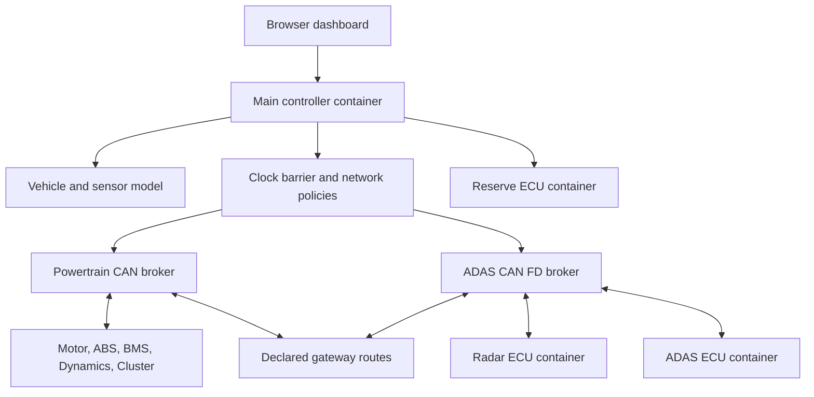

# ECU Lab · Distributed Vehicle Systems

The `feature` branch runs a container-based virtual vehicle network: **one main controller, seven independent ECU containers, and one reserve ECU container**. It includes CAN, CAN FD, ISO-TP diagnostics, synthetic radar and a functional ADAS closed loop.

## Run the complete system

```sh
git clone --branch feature https://github.com/yacine-boujelbenne/Virtual_CAN_Simulator.git
cd Virtual_CAN_Simulator
docker compose up --build -d --wait --wait-timeout 180
```

Open **http://localhost:8080**. Your normal GitHub authentication is needed for this private repository.

```sh
docker compose ps
docker compose logs -f simulator
docker compose down
```

Docker Desktop (Windows/macOS) or Docker Engine with Compose v2 (Linux) is required. There is no host CAN setup, privileged container, Docker socket mount, cloud API requirement or CDN dependency.

## One dashboard, six workspaces

| Workspace | What it shows |
|---|---|
| Vehicle | Synthetic road scene, driver/ACC/AEB controls, seven ECU nodes, container health, virtual hardware and live telemetry |
| Network control | Classic CAN/CAN FD segments, gateway routes, registry, message drop and latency policies |
| CAN analyzer | Protocol, BRS, segment, IDs, byte length versus DLC, raw bytes, decoded signals and delivery/drop status |
| Diagnostics | UDS requests over real ISO-TP framing to a selected ECU worker on classic CAN or CAN FD, encoded by the C++ session engine |
| ECU builder | JSON editor, seven templates, strict DBC subset import, optional AI adapter, validation, reserve-container assignment and the `.vcanproj` project file |
| Performance | Latency decomposition per ECU (sampled → computed → delivered → applied), bus load, backlog, throughput and a 30-second latency timeline |

The theme uses white, light green, green and charcoal. Purple is limited to a small navigation accent.

## Container layout



Every configured ECU container executes **one C++ behavior kernel**. Images are reused; ECU definitions configure their hardware profile and function. The central container computes the physical world, owns time and routes frames. It does not execute the distributed ECU tasks.

Containers share Docker's host OS kernel. Virtual CPU/RAM/flash, I/O and watchdog behavior are functional models, not instruction-set or electrical hardware emulation. See [architecture](docs/ARCHITECTURE.md) and [protocol research](docs/PROTOCOL_RESEARCH.md).

## Experiments

1. **Drive:** run and increase throttle. Follow decoded speed/RPM/SOC, CAN traffic and container CPU-budget metrics.
2. **Emergency braking:** click the AEB scenario. A 90 km/h ego vehicle approaches a stopped lead vehicle, 45 m away on a high-friction road. Follow radar FD frames, ADAS braking request, gateway delivery and ABS/motor response.
3. **ABS:** click the low-friction experiment and inspect brake-pressure modulation.
4. **Sensor failure:** inject a motor-temperature fault or disconnect the radar-distance sensor. Observe the owning ECU's DTC/state and downstream behavior.
5. **Network failure:** drop Radar ECU traffic on the ADAS bus. The ADAS ECU detects a stale perception input.
6. **Perception fusion:** bias the front-perception sensor by 10 m. The radar object list and the independent range measurement disagree, the forward-collision warning stays visible and emergency braking is inhibited.
7. **Multi-object radar:** the radar object list carries four slots: the lead vehicle, a static obstacle of the plant, and two empty slots. Disconnect the static-object sensor to invalidate only the second slot.
8. **Kernel failure:** select an ECU and halt it. The controller pauses the clock; other containers remain alive. Restore it and resume, or reset.
9. **Diagnostics:** read the demonstration VIN on classic CAN, then CAN FD. Inspect the actual SF/FF/CF/FC records.
10. **New ECU:** build an offline preview, review/validate it, and assign the reserve container. Reset releases that assignment.
11. **Reproducible project:** export the laboratory as a `.vcanproj` file, edit it, import it back and compare the SHA-256 project hash.
12. **Performance:** open the Performance workspace, drive the vehicle, then add a latency rule on the ADAS segment and watch the delivery p95 of the radar and ADAS ECUs move while the task cost stays flat.

## Native development

```sh
sudo apt-get install g++ cmake make libgtest-dev python3
cmake -S . -B build -DCMAKE_BUILD_TYPE=Release
cmake --build build -j2
ctest --test-dir build --output-on-failure
python3 tests/test_protocols.py -v
python3 tests/test_envelopes.py -v
python3 tests/test_adas_fusion.py -v
python3 tests/test_isotp_vectors.py -v
python3 tests/test_project_ab.py -v
python3 tests/test_performance.py -v
python3 app/run_local.py
```

The development launcher uses independent local processes instead of containers, with the same HTTP worker protocol. Production/default Compose uses separate containers. For a fast embedded-only development run, use `python3 app/server.py` without ECU_ENDPOINTS.

While the distributed application runs:

```sh
python3 tests/test_web.py -v
python3 tests/test_distributed.py -v
TEST_URL=http://127.0.0.1:8080 python3 tests/test_project_ab.py -v
```

Optional UI DOM checks:
```sh
npm install --prefix /tmp/vehicle-ui-check jsdom
NODE_PATH=/tmp/vehicle-ui-check/node_modules node tests/test_ui.cjs
```

The container build runs C++ tests. GitHub CI starts all nine services, checks their distinct container identities and runs HTTP/distributed integration tests.

## Definition and hardware model

[resources/ecu.schema.json](resources/ecu.schema.json) describes the shape. C++ validation also checks signal range/overlap, references, timing, TX collisions, RX interfaces and actuator ownership.

Definitions contain inputs, variables, periodic restricted-expression tasks, states, CAN messages, DTCs and a hardware profile. CAN FD uses legal wire lengths: 0–8, 12, 16, 20, 24, 32, 48 or 64 bytes. A signal may start above bit 64; it is packed into the full payload.

Modeled task cost scales with virtual CPU clock. Kernel snapshots report modeled CPU load and RAM/flash use. Compose separately limits actual container resources. A missing worker prevents a partial tick from advancing; duplicate retries return cached results.

Messages added through the UI are ephemeral. Download JSON and declare its path in the scenario plus its dedicated worker mapping in Compose to retain it. Extra simultaneous ECUs need extra worker services; no main-container fallback is used.

## Performance dashboard

The C++ core owns the simulation clock, so it also owns the measurements. Every snapshot carries a `performance` window:

| Metric | Meaning |
|---|---|
| Task cost | `computed_at_us - sampled_at_us` of the ECU kernel, per ECU (p50/p95/max/mean over a rolling window) |
| Delivery latency | from the producer's `computed_at_us` to the delivery of the frame on the bus, per producer; reacts to the flow policies |
| Actuation latency | from the ECU computation to the plant commit, at the tick boundary |
| Control chain | `sampled_at_us` → `applied_at_us`; quantized by the 10 ms barrier, so the variable part is the task cost |
| Throughput | frames per bus and per ECU (tx/rx), dropped frames, load estimate and backlog |

The dashboard renders those numbers and a 30-second timeline of task cost and delivery latency. `tests/test_performance.py` checks the ordering of the percentiles, the barrier quantization of the control chain, the drop counters and the reset of the measurement window.

## Project file (.vcanproj)

A project is a single JSON file that reproduces a laboratory: scenario, ECU definitions, the derived CAN map and the run configuration. `project_hash` is the SHA-256 of the canonical form of that content, computed by the C++ core; live controls and the simulation state stay outside the hash.

- `GET /api/project` exports the running project, `POST /api/project` imports one.
- Import is strict: a declared hash that differs from the recomputed one is refused with both values, and the running laboratory is left untouched.
- Import is transactional: the previous scenario and definitions are restored if the project cannot be applied.
- In distributed mode every imported ECU needs a dedicated worker endpoint, checked before anything changes.
- The dashboard exposes export/import and the live hash in the ECU builder workspace.

## Optional AI adapter

Without AI_ENDPOINT, the builder selects a local template and clearly reports that no LLM was called. The external adapter receives prompt/templates/schema_version and must return `{"definition": {...}}`. Its output is validated before assignment. Set AI_ENDPOINT and optional AI_API_KEY in `.env`; reachability is from the controller container. The current adapter contract is provider independent; a production RAG stack is not included.

## Scope

This is functional software-in-the-loop for learning and experimentation. It does not reproduce proprietary ECU firmware or implement a full ADS. CAN priority and estimated serialization are modeled; electrical errors, bit-exact CRC/stuffing, bus-off/recovery and real-time deadlines are not. ISO-TP supports normal and 11-bit extended addressing, 1–4095-byte PDUs and the N_As/N_Bs/N_Ar/N_Cr timeouts; the conformance vectors in `tests/vectors/isotp` replay the same scenarios against the C++ engine and a Python oracle. Diagnostic session/security gating, full automotive Ethernet/DoIP, raw perception, steering/lane models, hardware/HIL and persistent trace/replay remain future work. The `.vcanproj` project file reproduces a laboratory but is not a signed, versioned or encrypted artifact.

[Protocol research](docs/PROTOCOL_RESEARCH.md) records primary Linux and NHTSA sources and the exact boundaries.

## Third-party code

The original vendored nlohmann/json MIT header/notices are retained. GoogleTest is a build dependency. No proprietary standards text or OEM firmware is distributed.
