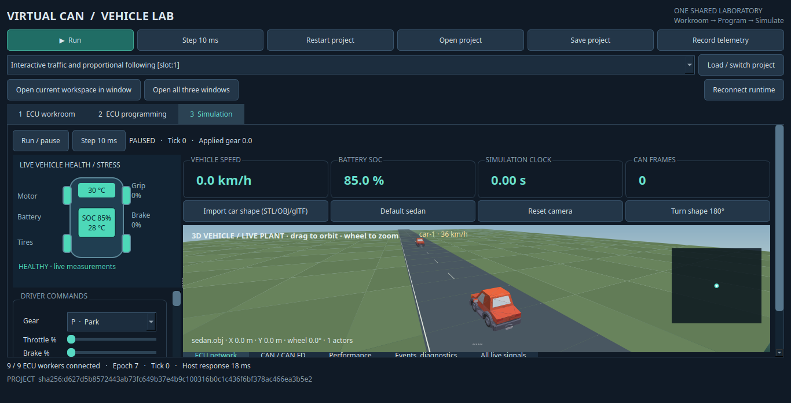

# Virtual CAN / Vehicle Lab

This is **showcase/web**, the optional browser branch. Start with
[showcase/README.md](showcase/README.md). The native product lives on
`platform/native`; its description and build instructions follow below.


A native C++20 vehicle experiment platform with a Qt desktop, a headless runner
and one isolated C++ process per ECU. The controller owns the simulation clock,
vehicle plant, CAN/CAN FD broker, project lifecycle and tick barrier.



## Run the platform

```sh
bash tools/run_native_desktop.sh
# Prepared proportional-following experiment: select Run
bash tools/run_native_desktop.sh --scenario resources/scenarios/ev_following_demo.json
# Workroom, programming and simulation in separate shared windows
bash tools/run_native_desktop.sh --windows
```

The desktop includes editable ECU topology/programs, live health and all-signal
inspection, geometric traffic and adjustable following, grip-aware driving physics,
faults, ISO-TP diagnostics, project switching, sampled telemetry and custom
STL/OBJ/glTF/GLB car shapes. Open `resources/projects/following_demo.vcanproj` for
the saved following example. [Controls and model limits](docs/INTERACTIVE_NATIVE_PLATFORM.md).

## Build and verify

Install CMake, a C++20 compiler and GoogleTest. Desktop builds additionally need
Qt 6 Widgets/Test and Assimp; Python/jsonschema is used only by regression drivers.
On this Ubuntu host, `bash tools/fetch_native_mesh_deps.sh` fetches local Assimp
packages under ignored `build/deps`. Point CMAKE_PREFIX_PATH at your Qt installation.

```sh
cmake -S . -B build/native -DCMAKE_BUILD_TYPE=Release \
  -DVEHICLE_LAB_DESKTOP=ON -DVEHICLE_LAB_P0_TESTS=ON \
  -DCMAKE_PREFIX_PATH="$HOME/Qt/6.8.3/gcc_64"
cmake --build build/native -j3
ctest --test-dir build/native --output-on-failure --no-tests=error -j3
```

Set `VEHICLE_LAB_DESKTOP=OFF` for headless builds. `BUILD_TESTING=OFF` removes
GoogleTest/Qt Test requirements. Native binaries do not require Python at runtime.
[Detailed build and desktop controls](native/DESKTOP.md),
[headless API](native/README.md), [physics](native/PHYSICS.md).

## Repository map

| Path | Responsibility |
| --- | --- |
| `app/*.cpp`, `headers/`, `src/` | Engine and executable entrypoints; original protocol compatibility |
| `native/` | Controller, worker transport, core contracts, world and Qt UI |
| `resources/` | Versioned ECU definitions, scenarios, saved examples, schemas and licensed assets |
| `tests/` | Active protocol, P0 oracle, runtime, desktop and coordinator regressions |
| `tools/` | Launch, dependency and development coordination tools |
| `docs/` | Current guides, architecture, verification and clearly labelled legacy reference |
| `coordination/` | Roadmap, task definitions, completion ledger and provenance |
| `build/native`, `build/deps` | Ignored operational build and local dependencies |

## Web showcase branch

`showcase/web` contains the optional browser showcase of this same native engine.
It is developed separately from `platform/native`. Browser requests delegate to
`vclab --realtime`; the browser and HTTP adapter do not advance an independent
vehicle clock. See that branch's `showcase/README.md` for launch and verification.
The older `web/` and Python adapters remain comparison fixtures, documented in
[legacy web/Compose reference](docs/LEGACY_WEB.md).

## Status and remaining roadmap

The delivered native workflow passed 81 CTest entries, a real Wayland desktop
workflow, a ten-minute following soak and a two-minute corrected pacing check.
[Current platform status](docs/PLATFORM_STATUS.md),
[compact verification record](docs/verification/native.json),
[orchestrator completion ledger](coordination/completions.json).

Physics is an educational planar model. Custom meshes are visual; collision uses
rectangles. Full durable runtime recording/replay, external esmini/CARLA world
adapters, path tracking/MPC and standalone installers remain explicit roadmap
items. See [the native roadmap](coordination/NATIVE_CPP_ROADMAP.md).
