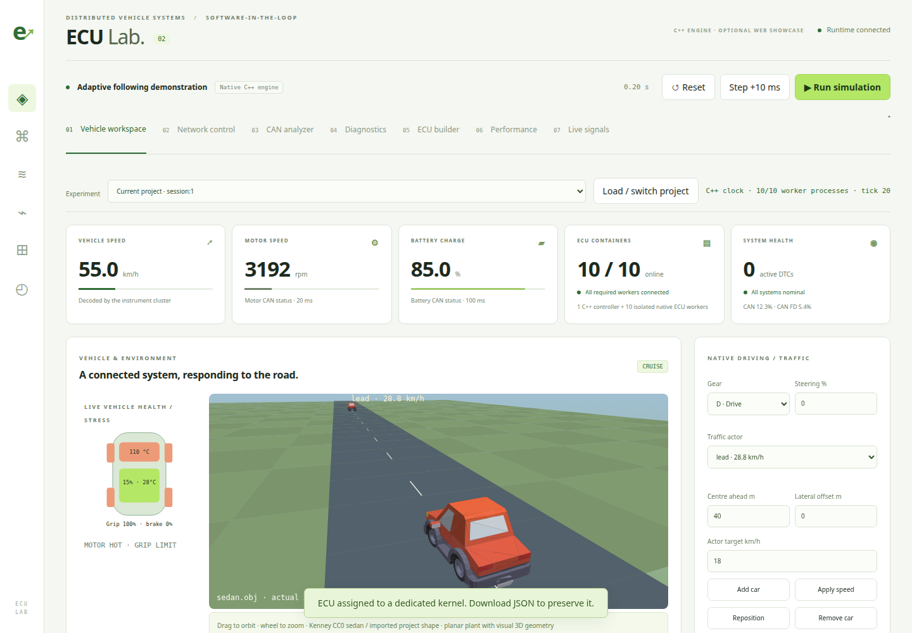
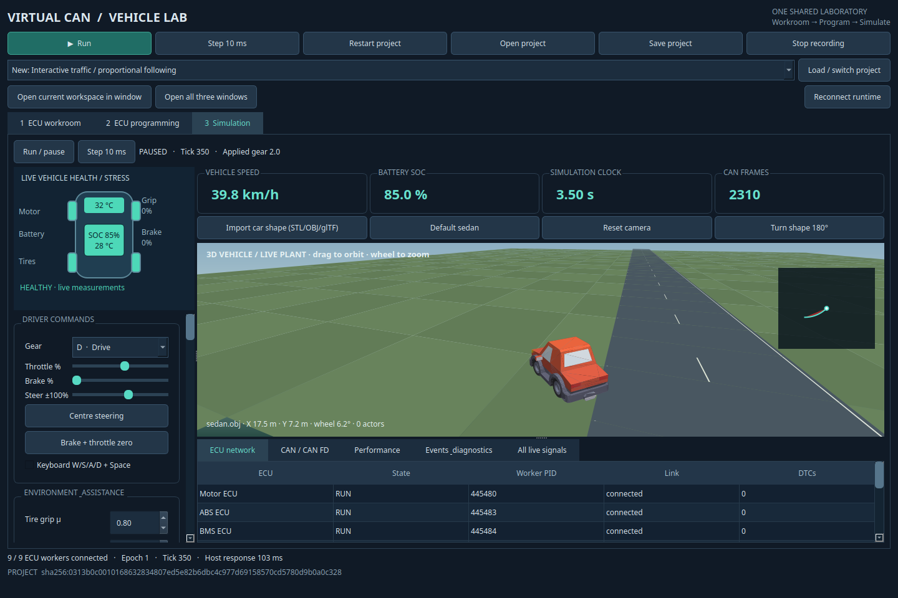

# ECU Platform — Native Engine Web Showcase

Explore a virtual vehicle, its electronic control units (ECUs), and their CAN traffic from your browser. This showcase provides driving controls, traffic experiments, ECU programming, diagnostics, and live performance views backed by the platform's **native C++20 simulation engine**.

**This checkout: `showcase/web` — the optional browser client.** The primary Qt desktop and engine are developed on `platform/native`. Both clients use the same engine design: one controller owns the clock and vehicle model, with one native worker process per ECU. Launching the showcase starts its own experiment; it does not attach to an already running desktop.

[Screenshots](#screenshots) · [Setup](#setup-and-launch) · [First experiment](#try-your-first-experiment) · [Desktop](#run-the-qt-desktop) · [Tests](#verification) · [Troubleshooting](#troubleshooting)

## What you can explore

| Workspace | Purpose |
| --- | --- |
| Vehicle workspace | Drive the vehicle, orbit the 3D view, inspect health, add traffic, tune adaptive following, and change physics settings. |
| Network control | Inspect ECU topology and worker status, edit/deploy runtime JSON programs, and apply traffic policies. |
| CAN analyzer | Inspect CAN/CAN FD traffic and decoded signals produced by the native experiment. |
| Diagnostics | Exchange ISO-TP diagnostic requests with ECUs, including reading a VIN. |
| ECU builder | Generate an observation ECU from an offline template, validate it, and add a dedicated worker to the experiment. |
| Performance | Inspect modeled task, delivery, and end-to-end timing along with bus activity. |
| Live signals | Inspect plant state, controls, sampled sensors, ECU variables, and modeled resource status. |

Projects can be exported and reopened as `.vcanproj` files. The browser can display custom car geometry embedded in projects authored by the desktop. The ECU editor uses the runtime JSON language; it does not compile arbitrary C/C++ firmware.

## Screenshots

### Browser vehicle workspace

The browser brings vehicle health, traffic controls, CAN-derived measurements, and the native vehicle view into one workspace. This existing demonstration capture includes an added observation ECU and an intentionally injected temperature fault.



### Native Qt desktop

The desktop provides ECU workroom, programming, and Simulation workspaces, plus direct STL/OBJ/glTF/GLB mesh import. This capture comes from the native offscreen driving demo with nine connected ECU workers.



## How it works

```text
Browser UI
    | HTTP commands and snapshot polling
Python standard-library HTTP/static adapter
    | JSON commands and responses
vclab --realtime (C++ controller)
    | one clock + vehicle model + CAN/CAN FD broker
Native C++ ECU worker processes
```

Physics, ECU execution, and simulation timing stay in C++. The Python adapter serves the browser and forwards commands. Browser polling and rendering do not advance simulation time.

## Setup and launch

### 1. Open the showcase source checkout

Use the `showcase/web` checkout containing `showcase/server.py`, `CMakeLists.txt`, and `tools/run_web_showcase.sh`. From the local `ECU_Platform` workspace:

```sh
cd Virtual_CAN_Simulator-web-showcase
```

If your checkout has another directory name, enter that directory instead. All commands below run from the repository root. The native-only branch does not contain the showcase launcher; obtain the showcase checkout rather than using the legacy `web/` adapter.

### 2. Install prerequisites

You need **Linux**, a **C++20 compiler**, **CMake 3.16+**, **Python 3**, and a modern browser. The native worker transport uses Linux process facilities. Qt, Assimp, Docker, and npm packages are not needed to run this browser client.

On Ubuntu/Debian:

```sh
sudo apt-get update
sudo apt-get install -y build-essential cmake python3
```

### 3. Build the native engine

```sh
cmake -S . -B build/native -DCMAKE_BUILD_TYPE=Release \
  -DBUILD_TESTING=OFF -DVEHICLE_LAB_DESKTOP=OFF
cmake --build build/native -j2
```

This produces `build/native/vclab` and `build/native/vclab_worker`. Keep the worker executable beside the controller.

### 4. Start the showcase

```sh
bash tools/run_web_showcase.sh
```

Open **http://127.0.0.1:8080**. The following demo starts paused in Drive, with the ego vehicle at 15 m/s behind a lead car moving at 8 m/s. The page should report a connected runtime and **9/9 worker processes**. Press **Run simulation** to begin; stop the server with **Ctrl+C** when finished.

The server binds to loopback by default. To use another port:

```sh
bash tools/run_web_showcase.sh --port 8081
```

To reuse an existing native engine build instead of compiling another:

```sh
bash tools/run_web_showcase.sh \
  --runtime /absolute/path/to/build/native/vclab
```

The sibling `vclab_worker` must exist. To start another built-in scenario:

```sh
bash tools/run_web_showcase.sh --scenario resources/scenarios/ev_interactive.json
```

## Try your first experiment

1. Start the default showcase and press **Run simulation**. Watch the ego vehicle respond to the slower lead car through radar, ADAS, and CAN actuation.
2. Change the traffic actor's target speed or add another car. Tune cruise speed and following gaps, then apply adaptive following.
3. Pause the run and inspect **CAN analyzer**, **Performance**, and **Live signals**. Stepping advances the native simulation by 10 ms.
4. In **Diagnostics**, select **Motor ECU** and send the VIN request. The response travels through the C++ ISO-TP implementation.
5. Inspect an ECU program in **Network control**. Validate a draft before deploying; deployment restarts the project with fresh workers.
6. Export a `.vcanproj` to preserve the deployed configuration. Open it later to start a fresh run with the same configuration.

Project switching and physics deployment restart the experiment. Live state injections change values such as temperature or charge during a run. Session project slots are in memory; export a project for persistence across server restarts.

See the [showcase guide](showcase/README.md) for the full demonstration and verification workflow.

## Run the Qt desktop

This checkout also contains the native desktop sources. Install Qt 6.2+ Widgets and Assimp, then enable the desktop target:

```sh
sudo apt-get install -y qt6-base-dev libassimp-dev

cmake -S . -B build/native -DCMAKE_BUILD_TYPE=Release \
  -DBUILD_TESTING=OFF -DVEHICLE_LAB_DESKTOP=ON
cmake --build build/native -j2
bash tools/run_native_desktop.sh
```

For a separate Qt SDK, add `-DCMAKE_PREFIX_PATH="/path/to/Qt/version/gcc_64"` when configuring. Use `bash tools/run_native_desktop.sh --windows` to open three shared workspace windows, or pass `--scenario resources/scenarios/ev_following_demo.json` for the prepared following demo.

The desktop requires a graphical Linux session. It offers the full topology workroom and direct mesh import; the browser loads custom geometry through saved native project files. See [desktop controls](native/DESKTOP.md) and the [interactive platform guide](docs/INTERACTIVE_NATIVE_PLATFORM.md).

## Headless experiments

The same engine can run without either UI. From the repository root:

```sh
./build/native/vclab \
  --scenario resources/scenarios/ev_following_demo.json \
  --steps 100 --save-project build/native/following.vcanproj

./build/native/vclab --project build/native/following.vcanproj --steps 100
```

Each command prints a JSON snapshot and exits. Fixed-step runs do not pace themselves against wall time. See the [headless API](native/README.md) for JSON commands and native/HTTP worker transport.

## Verification

Run the HTTP integration tests against the built native engine:

```sh
VCLAB_RUNTIME="$PWD/build/native/vclab" \
  python3 tests/showcase/test_native_showcase.py
```

Browser verification additionally requires Node.js/npm and the pinned Playwright package. These are test dependencies only:

```sh
npm ci --prefix showcase
npx --prefix showcase playwright install chromium --only-shell
VCLAB_RUNTIME="$PWD/build/native/vclab" npm test --prefix showcase
```

The suites start their own server and native workers. The browser workflow checks all seven workspaces, driving, ECU deployment, diagnostics, project roundtrips, and a narrow-screen layout. Screenshot evidence defaults to `/tmp/vclab-showcase-evidence`; set `SHOWCASE_EVIDENCE` to change it. See [verification setup notes](showcase/README.md#verify) for host-specific browser installation details.

To enable the engine's native and Python regression suites:

```sh
sudo apt-get install -y libgtest-dev python3-jsonschema
cmake -S . -B build/native -DCMAKE_BUILD_TYPE=Release \
  -DBUILD_TESTING=ON -DVEHICLE_LAB_DESKTOP=OFF \
  -DVEHICLE_LAB_P0_TESTS=ON
cmake --build build/native -j2
ctest --test-dir build/native --output-on-failure --no-tests=error -j2
```

The [recorded browser verification](docs/verification/web.json) and [native verification](docs/verification/native.json) are dated historical results, not a substitute for checking a new build.

## Troubleshooting

| Symptom | What to check |
| --- | --- |
| `tools/run_web_showcase.sh` is missing | Use the `showcase/web` checkout. The primary native branch has a different launcher. |
| Server asks you to build `vclab/vclab_worker` | Complete the engine build or pass `--runtime` with the absolute path to an executable controller. |
| Runtime fails to start | Keep `vclab_worker` beside `vclab`; ensure the environment permits child processes and local IPC. |
| Port 8080 is already in use | Pass `--port 8081` and open the matching URL. |
| Browser cannot connect | Keep the launcher running and open the URL on the same host; `127.0.0.1` is local to that machine. |
| Simulation appears paused | Press **Run simulation**; the prepared demo intentionally starts paused. |
| A custom car shape cannot be imported directly | Import the source mesh in the Qt desktop, save the project, then open that `.vcanproj` in the browser. |
| Browser tests cannot launch Chromium | Install the pinned npm dependencies and Playwright browser; consult the host setup notes linked above. |

## Repository and further reading

| Path | Purpose |
| --- | --- |
| `showcase/` | Browser UI and Python HTTP/static adapter. |
| `app/`, `headers/`, `src/`, `native/` | Native engine, worker processes, protocols, and Qt desktop. |
| `resources/` | ECU programs, scenarios, schemas, projects, and car assets. |
| `tests/showcase/` | Real-engine HTTP and browser integration checks. |
| `tools/` | Launchers and development utilities. |
| `docs/`, `coordination/` | Guides, screenshots, verification, architecture, and roadmap. |

- [Architecture](docs/ARCHITECTURE.md)
- [Physics and model limits](native/PHYSICS.md)
- [Platform status](docs/PLATFORM_STATUS.md)
- [Roadmap](coordination/NATIVE_CPP_ROADMAP.md)
- [Legacy web/Compose reference](docs/LEGACY_WEB.md)
- [Default vehicle asset provenance and CC0 notice](resources/models/default-car/PROVENANCE.md)

The vehicle model is educational and planar. Meshes are visual; contacts use rectangles. Full durable recording/replay, external esmini/CARLA integration, path tracking/MPC, and standalone installers remain roadmap items. The old Python controller and Compose workflow are separate legacy comparison paths.
