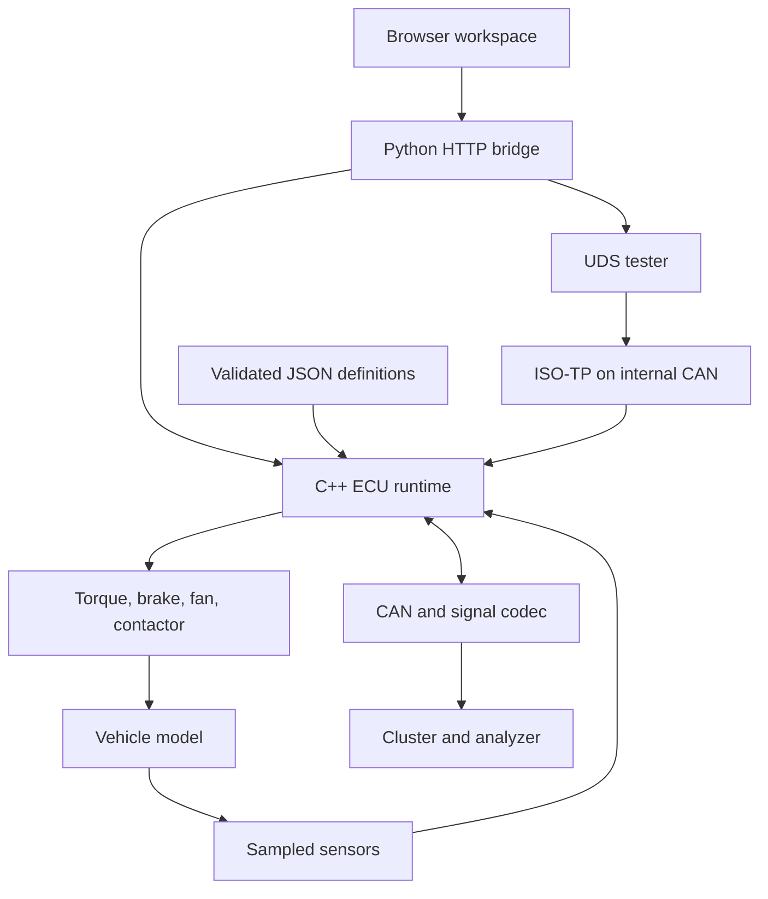

# Virtual Vehicle Network & ECU Simulation Platform

The `feature` branch evolves the C++ CAN simulator into a runnable five-ECU vehicle lab. One container serves the browser workspace and runs the C++ simulation. No host CAN device, privileged container, API key, frontend build step, or GoogleTest Git checkout is needed.

## Start the entire project

Install Docker Desktop (Windows/macOS) or Docker Engine with Compose v2 (Linux), then:

```sh
git clone --branch feature https://github.com/yacine-boujelbenne/Virtual_CAN_Simulator.git
cd Virtual_CAN_Simulator
docker compose up --build -d --wait
```

Open **http://localhost:8080**. The repository is private: use your normal GitHub authentication when cloning. The web app has no login.

```sh
docker compose logs -f
docker compose down
```

To change the host port, copy `.env.example` to `.env` and set `SIM_PORT=8090`, then reopen at that port. The default Compose mapping binds to localhost.

## What works

| Area | Implemented behavior |
|---|---|
| C++ core | Classic CAN, isolated internal broadcast endpoints, optional SocketCAN endpoints, fixed 10 ms clock |
| ISO-TP | Single/multi-frame transfers, 1–4095 byte payloads, block sizes including 0, peer STmin, sequence wrap, bounded timeouts |
| Generic ECU runtime | JSON definitions, named inputs and variables, periodic tasks, restricted expression trees, state transitions, actuator bindings |
| Signals | Intel/little-endian signed/unsigned integers, scaling and offsets, representable-range and overlap checks |
| Vehicle | Simplified longitudinal acceleration, braking, wheel slip, motor RPM, energy use, battery SOC and temperatures, fan cooling |
| Five demo ECUs | Motor, ABS, BMS, dynamics measurement, instrument cluster |
| Sensors | Sampling, reproducible Gaussian noise, stuck value, disconnected, bias, amplified noise |
| Diagnostics | Active/stored DTCs; UDS 0x10, 0x14, 0x19/02, 0x22, 0x3E via real ISO-TP framing over an internal CAN channel |
| Browser workspace | Drag ECU nodes, live graphs, driver controls, inspector, CAN analyzer/decoded signals, DTCs, diagnostic tester |
| Interoperability | Strict DBC subset importer, editable JSON, definition download, recent 200-frame CSV export |
| ECU builder | Offline template selection; optional external AI adapter; all definitions validated before use |

The UI is served locally and has **no CDN or JavaScript package dependencies**. It uses browser-native SVG and canvas; the C++ engine owns the simulation state. UI polling does not advance simulation time.

## First experiments

1. Click **Run simulation**; raise throttle to 60%. Observe speed, RPM, SOC, and CAN payloads.
2. Click **Load ABS experiment**. This accelerates the vehicle for 20 simulated seconds, switches to low-friction braking, and starts the clock. Inspect ABS pressure/state.
3. Select the motor temperature sensor, inject **stuck at 120**, and run/step. Motor torque is inhibited, fan command activates, P0217 is stored, and the cluster receives a warning.
4. Restore the sensor. The fault recovers below the threshold, but its stored DTC remains.
5. Open **Diagnose**, select Motor ECU, and read DTCs. Read the demonstration VIN to exercise a multi-frame response.
6. Open **Design & build**, describe an ABS ECU, and build an offline preview. Review JSON, validate, then add an observation-only ECU.

Raw templates reuse actuator owners and CAN IDs. Adding such a template without adapting them intentionally fails. Offline previews remove actuator bindings and allocate unused TX IDs. Definitions added in the UI are in-memory: reset/restart reloads the original scenario. Download JSON and add it to the scenario's `ecus` list to persist a model.

## Architecture



See [docs/ARCHITECTURE.md](docs/ARCHITECTURE.md) for timing, units, schema, diagnostics and limitations.

## Native development (optional)

On Debian/Ubuntu:

```sh
sudo apt-get install g++ cmake make libgtest-dev python3
cmake -S . -B build -DCMAKE_BUILD_TYPE=Debug
cmake --build build -j2
ctest --test-dir build --output-on-failure
python3 app/server.py
```

Run HTTP checks while the server is running:

```sh
python3 tests/test_web.py -v
```

Optional DOM smoke test (test-only dependency):
```sh
npm install --prefix /tmp/vehicle-ui-check jsdom
NODE_PATH=/tmp/vehicle-ui-check/node_modules node tests/test_ui.cjs
```

The container build executes C++ tests; GitHub Actions additionally starts the image and executes HTTP integration checks. Building just the runtime without tests is supported with `-DBUILD_TESTING=OFF`.

The console executable accepts one JSON command per line:

```sh
printf '%s\n' '{"action":"controls","values":{"throttle":0.6}}' '{"action":"step","count":1000}' | ./build/vehicle_sim
```

Core commands: `snapshot`, `run`, `pause`, `reset`, `step`, `controls`, `fault`, `validate`, `add_ecu`, `diagnostic`. The HTTP service drives `advance` internally every 100 ms. A delayed callback slows wall-clock playback; it does not change the fixed integration step.

## Optional AI adapter

Without configuration, `/api/generate` selects a local template. It **does not call an LLM or implement semantic RAG**. It reports the actual provider.

Set `AI_ENDPOINT` to your provider adapter URL and optionally `AI_API_KEY` in `.env`. The adapter receives:

```json
{"prompt":"Create a controller...","templates":{"abs":{},"bms":{}},"schema_version":1}
```

It must return `{"definition": {...}}` within 45 seconds. It can use any LLM/RAG implementation behind that contract. The key is sent as a bearer token to the configured endpoint; it is never sent to the browser. Configure a reachable container-network URL; localhost inside the container refers to the container itself. Returned definitions pass the C++ validator and a separate network check when added. The simulator never compiles or executes generated source code.

## Scope and next milestones

This is a complete **educational V1**. It is not a validated production-vehicle model or a complete UDS/ISO standards implementation. CAN priority is ordered within each tick; serialization timing, bit stuffing, error confinement, bus-off and overload scheduling are not modeled. Diagnostics use an isolated internal bus and a selected virtual target, not per-ECU production diagnostic IDs. UDS sessions are acknowledged but do not gate other services. VIN/speed DIDs and DTC wire codes are demonstration conventions.

SocketCAN is an optional library endpoint, not the default dashboard backend; creating `vcan` remains an operator task. CAN FD, Motorola/multiplexed DBC, OBD-II, gateways, hardware integration, native plugin loading, sophisticated ABS/thermal physics, persistent trace/replay and production RAG are future milestones. No proprietary OEM controller firmware is reproduced.

## Third-party code

`headers/json.hpp` is the original vendored nlohmann/json header with its MIT license notices retained. GoogleTest is installed as a build dependency. No code or datasets from the reference ECU repositories were copied.
