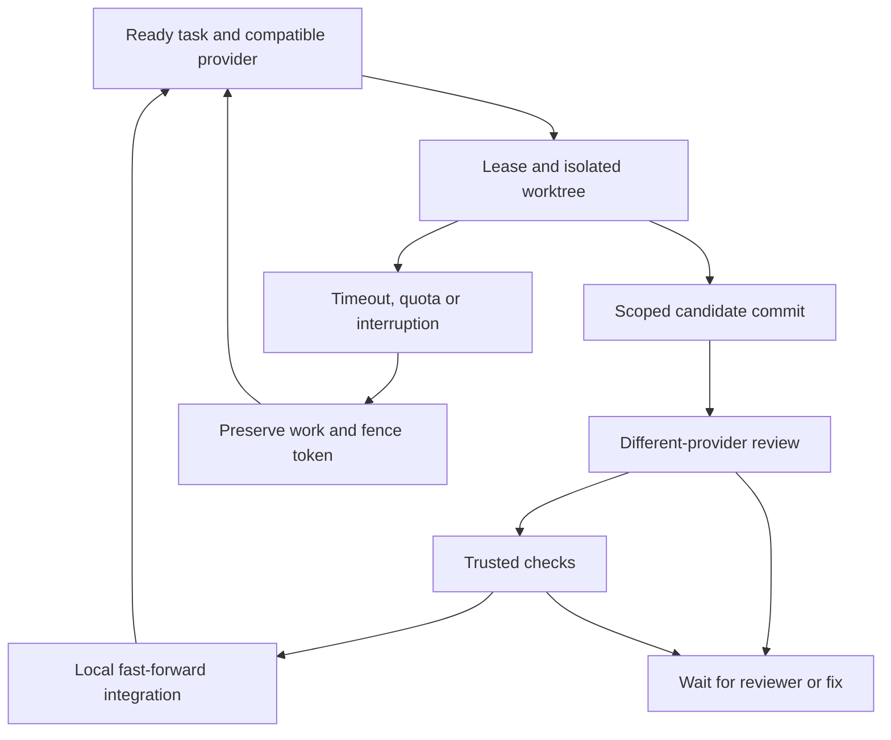

# Operating the three-provider cycle

## What is automated, and what is not

The supplied coordinator is executable Python development tooling using Git and SQLite only. It can start configured CLI processes, preserve worktrees, collect structured reports, select a different capable provider, obtain a different-provider review, execute frozen checks and fast-forward a local integration branch. It does not log into accounts, invoke the VS Code extension as a process, discover remaining token balances, install tools, acquire quota, change billing models or push to GitHub.

Markdown supplies project policy/context. SQLite transactions, expiring leases, isolated Git worktrees, report validation and checks implement coordination. They support cooperating agents; they are not an operating-system sandbox against hostile agents. Configure each provider's own path/tool permissions and review the repository before enabling execution.

The implementation dispatches one automatic provider attempt at a time. Manual IDE participants may hold independent leases concurrently; scope conflicts are serialized. This keeps the loop inexpensive and debuggable. It is not a claim of three simultaneous cloud agents running here.

## 1. Prepare the source and tools

Work in the user's checkout that contains the real P0 implementation. Preserve dirty files first and identify the baseline SHA. Overlay/merge this pack without replacing root README/CHECKPOINT or existing local guidance. Commit the coordination files so new worktrees actually contain LAW/role files and tools. Do not start `init` from an uncommitted copy of the pack.

Run:

```sh
python3 tools/validate_coordination.py
python3 -m unittest discover -s tests/orchestration -v
python3 tools/check_baseline.py --verify-p0
python3 tools/coordinate.py doctor
```

Doctor reports executable presence only. In this environment Codex, OpenCode, Copilot, Docker and CMake were absent; a `code` executable did not establish an authenticated Copilot agent. On your machine verify each CLI's version/help, local login and a small bounded read/write task in a disposable repository. Do not copy credentials into provider JSON or reports.

Copy `coordination/providers.example.json` to `coordination/providers.local.json` and configure the installed commands. The example is disabled and unverified on purpose. Set `enabled: true` and `verified_local: true` only for an adapter you have tested. Model names are deliberately unspecified because availability/limits depend on your account and selected backend. A permission rejection pauses that adapter; it is never answered by adding `--yolo`, unrestricted tools or an automatic paid model switch.

OpenCode's example uses `opencode run --agent ecu-core --format json`. Its configured agent still asks for commands outside narrow permissions. Codex uses `codex exec --sandbox workspace-write`. Copilot's optional CLI example grants read/write tools; its test shell commands still require local permission configuration. The coordinator itself runs trusted checks after review. Exact flags are examples from the inspected official docs and must match your installed clients.

## 2. Initialize and run

From the control checkout:

```sh
python3 tools/coordinate.py init
python3 tools/coordinate.py status
python3 tools/coordinate.py run --max-calls 6 --max-wall-seconds 1800
```

`init` creates `work/native-cpp` at the current committed HEAD and checks it out under `.orchestrator/integration`. It does not switch the user's current branch. All candidates use separate worktrees under `.orchestrator/worktrees/`. Temporary data and local provider configuration are excluded through `.git/info/exclude`, not by replacing the project `.gitignore`. If that branch is already checked out elsewhere, resolve the location rather than forcing it.

Each task is immutable after import into the database. Add newly scoped task IDs to tasks.json and re-run init to extend the queue; do not silently change acceptance criteria for an in-flight/completed ID. Existing records/statuses are retained. Runtime progress and the event ledger are local and persistent; back up the control checkout's `.orchestrator` directory with its SQLite WAL/SHM consistently when the coordinator is stopped. Worktrees/branches are evidence and must not be discarded during backup/cleanup.

## 3. One task attempt



1. Coordinator selects a ready task whose dependencies are DONE and whose write scopes do not overlap an active writer. Preferred lanes rank assignments; compatible fallbacks remain eligible.
2. It creates a fresh branch/worktree at the integration head, leases the task and writes `.handoff/ticket.json` plus a team-status snapshot. Never hand two agents the same checkout.
3. The provider reads the shared law, role and ticket, implements one scoped commit, and writes `.handoff/report.json`. No root control files or another task's source is changed.
4. A different capable provider reviews the exact candidate in a separate detached worktree. The author cannot claim that review. Review cannot change source or move HEAD.
5. Coordinator runs the task's preconfigured argv checks. Model-provided test commands/results are notes, not executable acceptance policy.
6. If checks pass and the integration head is still the candidate's base, local fast-forward integration marks DONE. If the head advanced, the task returns READY and the next attempt must reuse/revalidate its preserved patch on the fresh base and obtain a new review. There is no automatic conflict resolution or force merge.

The initial task graph contains 22 slices, not 22 completed features. BASE-00 deliberately blocks when source matching the checkpoint is missing. PLAN-00 is independent documentation work; blocked source does not justify editing imagined runtime files.

## 4. Report protocol

```json
{
  "task_id": "CORE-00",
  "claim_token": "COPY_EXACT_TOKEN_FROM_TICKET",
  "outcome": "ready_for_review",
  "candidate_commit": "EXACT_COMMIT_SHA",
  "summary": "Concrete behavior changed; remaining limitations.",
  "tests": [
    {"command": "ctest --test-dir build/native --output-on-failure", "result": "Actual result, or not run and why"}
  ]
}
```

Implementation outcomes: ready_for_review, partial, blocked, capacity. Review outcomes: approve, reject, blocked, capacity. Correlation fields are required. `partial` preserves work and permits a fresh attempt. `capacity` also cools down the provider. `blocked` requires a concrete resolution before operator unblocking. For reviews include the exact ticket candidate commit.

If stopping early, include `last_command`, `files_changed`, `next_action`, `blocker` and any partial commit in the report. The coordinator keeps the worktree even if a report is absent. It never deletes that partial source or pretends it passed.

## 5. VS Code Copilot or another manual participant

Keep Copilot `mode: manual` and set enabled after it is ready. Claim from the CONTROL checkout:

```sh
python3 tools/coordinate.py claim --provider copilot
```

Open the returned worktree in a separate VS Code window. Ask Copilot to read COPILOT.md and `.handoff/ticket.json`. Keep an external heartbeat from the control checkout while working:

```sh
python3 tools/coordinate.py heartbeat --task TASK-ID --token TOKEN
```

The default lease is 180 seconds. Manual work needs renewal before expiry; adjust the local lease duration for interactive work. Use a local timer/terminal to renew; the markdown file cannot renew itself. Never resume a lease that has expired. Submit the report from the control checkout using its full path:

```sh
python3 tools/coordinate.py submit --task TASK-ID --token TOKEN --report /absolute/worktree/.handoff/report.json
```

This is also the handoff protocol for Codex in ChatGPT/IDE when no CLI exists. `--root /absolute/control/checkout` appears BEFORE the subcommand if invoking the coordinator from elsewhere. Do not initialize another control database inside an attempt worktree.

## 6. Provider exhaustion and recovery

| Event | Behavior |
| --- | --- |
| Provider reports quota/context exhaustion | Preserve attempt, fence claim, cooldown provider, try another enabled compatible one |
| Missing executable | Mark adapter missing; other providers proceed; restore executable and resume explicitly |
| Authentication/permission failure | Mark auth_blocked; no auto approval/account switch; resume after local fix |
| Timeout/stop/output budget | Terminate the coordinator-owned child process group, retain logs/worktree and requeue within attempt budget |
| Coordinator crash | SQLite/branches persist; expired tokens are invalid and old worktrees are quarantined; fresh attempts use new worktrees |
| Only author is available to review | Wait for a different provider/human; independent ready tasks can continue |
| All providers unavailable / all tasks blocked | Exit with WAITING, or bounded watch mode; no invented work or tight retries |

The coordinator does not parse an exact remaining-token counter. A normal nonzero failure is cooled down even if classification is uncertain. Authentication/missing-tool cases require explicit resume. Logs have basic token-pattern redaction, not a guarantee that arbitrary application output is secret-free; agents must not print credentials.

```sh
python3 tools/coordinate.py pause --provider opencode --seconds 1800
python3 tools/coordinate.py resume --provider opencode
python3 tools/coordinate.py unblock --task BASE-00 --reason "Checkpoint source restored at VERIFIED_SHA"
python3 tools/coordinate.py run --max-calls 10 --max-wall-seconds 3600 --watch --idle-seconds 15
```

Create `.orchestrator/STOP` to stop new dispatch and terminate the current managed attempt. Remove it deliberately before restart. The wall budget bounds provider dispatch; trusted-check timeout is separate and a check already running may finish after that budget. Maximum implementation attempts default to four per task. Changing the retry policy is an operator decision, not a provider's way around a failure.

## 7. Progress, evidence and release

`python3 tools/coordinate.py export` regenerates `.orchestrator/STATUS.md` and `.orchestrator/progress/{OPENCODE,COPILOT,CODEX}.md` from SQLite events. Every new ticket includes the team status. Read the role's static progress handoff as background, and the generated snapshot as current state. Refresh after another provider finishes or blocks. An unavailable provider's worktree/last log and commit are explicitly listed in events.

Local integration is not remote publication. Inspect the integration branch and rerun release checks before opening/pushing a PR. Never merge master/main or deploy as part of a provider task. No unattended loop was started in this environment; configure/authenticate it on the machine containing the real P0 baseline.
