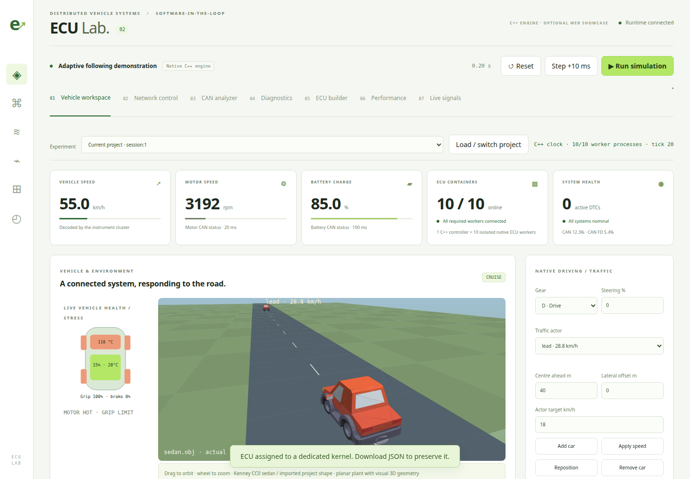

# Native engine web showcase

This directory contains the optional browser client of the C++ vehicle engine.
The `main` branch includes both interfaces; see the [root setup guide](../README.md).
The native Qt desktop remains the primary authoring application.
The HTTP/static adapter owns no physics, scheduling loop or ECU kernels: every
command and snapshot comes from `vclab --realtime`, which owns one clock and one
native worker process per ECU. Launching the showcase creates its own experiment;
it does not attach to an already running Qt desktop session.



## Run

Build the native CLI and workers in this checkout, or reuse the primary checkout's
binary with `--runtime` (the sibling vclab_worker must also exist):

```sh
cmake -S . -B build/native -DCMAKE_BUILD_TYPE=Release \
  -DBUILD_TESTING=OFF -DVEHICLE_LAB_DESKTOP=OFF
cmake --build build/native -j3
bash tools/run_web_showcase.sh
# Or reuse an existing engine build:
bash tools/run_web_showcase.sh --runtime /absolute/path/to/build/native/vclab
```

Open **http://127.0.0.1:8080**. The prepared following project starts paused in D,
at 15 m/s, behind an 8 m/s lead. Select Run. The HTTP edge uses Python's standard
library; production simulation remains C++. No npm installation/CDN is needed
to operate the showcase. `--port`, `--host`, `--scenario` and `--runtime` are explicit.
The default bind address is loopback.

## Demonstrate the platform

- Top-left health reports physical temperatures, charge, tire demand, brake and
  sensor/DTC/worker/contact warnings. CAN cluster measurements update through
  ECU sampling; plant injections appear in health before the next sampled frame.
- Drag/wheel the 3D car view. Geometry, colors and wheel tags were baked by the
  same C++ CarMesh importer used by the desktop. Scene placement and wheel
  steering use native state. Imported native projects can supply embedded meshes.
- Add another car, change its target speed, reposition or remove it. Change cruise
  cap/time gap/standstill gap/gain and apply adaptive following. Inputs reach
  radar/ADAS/CAN actuation; actors move in the native geometric world.
- Apply grip, grade, wind, vehicle mass, reduction, brake capacity or torque clamp.
  Configuration changes validate and restart the project; state stress is live.
- Switch templates or session projects. Export/Open `.vcanproj` for durable files.
  Project JSON is preserved as text so JavaScript does not lose the numeric types
  used by existing native canonical hashes. Session slots are in memory.
- Inspect topology, select an ECU, edit/deploy its actual JSON program, add an
  observation ECU, adjust bus policies, read ISO-TP diagnostics and inspect
  performance or all live signals. Renderers and HTTP polling do not advance time.

The native desktop remains the full Workroom/mesh-import authoring application.
This web showcase imports custom geometry through saved native project files;
it does not implement a second STL loader. Physics remains planar/educational,
rectangles define contact, and full runtime recording/replay, external world
backends and tracking/MPC retain their separate roadmap gates. The old Python
controller/Compose path is a historical comparison, not this branch's launcher.

## Verify

```sh
VCLAB_RUNTIME=/absolute/path/to/vclab python3 tests/showcase/test_native_showcase.py
npm ci --prefix showcase
npx --prefix showcase playwright install chromium --only-shell
VCLAB_RUNTIME=/absolute/path/to/vclab npm test --prefix showcase
```

The HTTP suite starts the real controller/workers, tests clock authority,
traffic/following/CAN, strict project and mesh roundtrips, diagnostics and stress,
and checks owned-process cleanup. The Playwright workflow exercises actual
browser controls, ECU deployment with physical steering impact, project
switching/download/import, all seven workspaces, health and a 390 px layout.
The dev dependency is pinned in package-lock.json; Node/npm are verification only.
Playwright setup follows its [official browser documentation](https://playwright.dev/docs/browsers).
On the tested Ubuntu 26.04 host the pinned test package required
`PLAYWRIGHT_HOST_PLATFORM_OVERRIDE=ubuntu24.04-x64` for browser installation.
CI explicitly uses Ubuntu 24.04. An unavailable browser is a failed setup gate.
Evidence defaults to `/tmp/vclab-showcase-evidence` and can be redirected with
`SHOWCASE_EVIDENCE`. Keep compact verification records rather than accumulated logs.

Verified locally: a clean native Release build, **5/5 HTTP integration tests**,
and the complete Chromium workflow passed, including ECU creation, diagnostics
and canonical project download/import. [Compact evidence](../docs/verification/web.json).

The standard full native suite remains available through CTest in the primary
checkout. The native engine sources are unchanged by this showcase branch.
